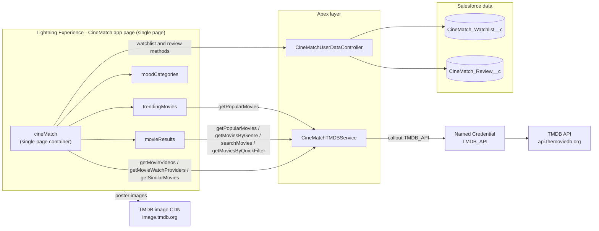
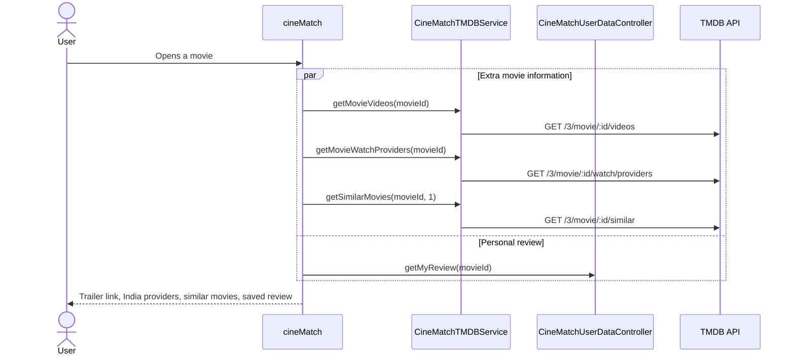

# CineMatch 360 – Project Documentation

This document explains how CineMatch 360 is built. Everything here comes from the source code in this repository.

**Contents**

1. [Project overview](#1-project-overview)
2. [Repository scope](#2-repository-scope)
3. [Technology stack](#3-technology-stack)
4. [Architecture](#4-architecture)
5. [Lightning Web Components](#5-lightning-web-components)
6. [Apex classes](#6-apex-classes)
7. [Custom objects and fields](#7-custom-objects-and-fields)
8. [API integrations](#8-api-integrations)
9. [Security and data access](#9-security-and-data-access)
10. [Installation and deployment](#10-installation-and-deployment)
11. [Testing](#11-testing)
12. [Developer tooling](#12-developer-tooling)
13. [Known limitations and maintenance notes](#13-known-limitations-and-maintenance-notes)
14. [Screenshots to add](#14-screenshots-to-add)
15. [Credits](#15-credits)

---

## 1. Project overview

CineMatch 360 is a movie discovery and personal collection app that runs inside Salesforce Lightning Experience. It is a Lightning Web Components (LWC) app with an Apex backend.

It is a **single-page application**. Home, My Movie Space, Trending (Popular Picks) and Discover are sections of the same page, drawn by one container component (`cineMatch`). My Watchlist and the movie details modal open on that same page when the user asks for them. There are no separate pages or routes (see [4.6](#46-single-page-layout-and-navigation)).

The app loads movie data from the **TMDB API**. Apex calls TMDB through a **Named Credential**, so no token is stored in the code. A user can:

- see a cinematic hero banner and a **My Movie Space** dashboard (saved movies, genres collected, current mood),
- see a **Collection Spotlight** with their highest-rated saved movie,
- see popular movies (**Popular Picks**),
- pick a mood (Feel Good, Emotional, Thriller or Action) to find movies by genre,
- use **Quick Discovery** (Under 2 Hours, Top Rated, Hidden Gems, Family Night or Weekend Watch),
- search by title and filter or sort the results, with pagination,
- open a movie to see its YouTube trailer link, India streaming provider buttons and similar movies,
- keep a personal **watchlist** (add and remove movies),
- save a personal **rating and review** (1 to 10),
- see loading skeletons and empty states while content loads or when there is nothing to show.

Watchlist entries and reviews are saved in two Salesforce custom objects. Each user only sees their own records.

Everything listed above is implemented in the source code. Ideas that are **not** built are kept separate in [13.1](#131-future-enhancement-ideas-not-implemented).

---

## 2. Repository scope

This repository is a Salesforce DX project (`sfdx-project.json` name: `SalesforcePractice`). It holds the CineMatch 360 app **and** other practice code from learning Salesforce.

| Area                                        | What it contains                                                                                                  | Part of the running CineMatch 360 app?                                                         |
| ------------------------------------------- | ----------------------------------------------------------------------------------------------------------------- | ---------------------------------------------------------------------------------------------- |
| Main CineMatch LWC components               | 4 bundles: `cineMatch`, `trendingMovies`, `moodCategories`, `movieResults`                                        | Yes                                                                                            |
| Additional CineMatch wrapper bundles        | 3 bundles: `cineMatchTrending`, `cineMatchDiscover`, `cineMatchWatchlist`                                         | No. They are in the repository but nothing uses them (see [5.1](#51-cinematch-360-components)) |
| CineMatch Apex                              | 2 service classes + 2 test classes                                                                                | Yes                                                                                            |
| CineMatch metadata                          | 2 custom objects, Named Credential, External Credential, 2 permission sets, app page, tab, 1 static resource used | Yes                                                                                            |
| Practice LWC components                     | 49 standalone bundles (see [5.2](#52-practice-components-not-used-by-cinematch))                                  | No                                                                                             |
| Practice Apex classes                       | 11 classes (see [6.3](#63-other-apex-classes-in-the-repository))                                                  | No                                                                                             |
| Practice Aura component and message channel | `AuraLwcCommunication`, `SampleMessageChannel`                                                                    | No                                                                                             |

Totals in the repository: **56** LWC bundle folders (4 main + 3 wrapper + 49 practice) and **15** Apex classes (4 CineMatch + 11 practice).

**LWC bundle folders and JavaScript files are two different counts.**

| Count                                              | Value | What it measures                                           |
| -------------------------------------------------- | ----- | ---------------------------------------------------------- |
| LWC bundle folders in `force-app/main/default/lwc` | 56    | One folder per component: 4 main + 3 wrapper + 49 practice |
| `.js` files under the same folder                  | 61    | 55 component JavaScript files + 6 Jest test files          |

The 55 component JavaScript files are one per bundle, except `sharedCss`: it is a CSS-only bundle with no `.js` file (56 - 1 = 55). The 6 Jest files are in `__tests__` folders (see [11](#11-testing)). The `jsconfig.json` file in the `lwc` folder is a configuration file, not a bundle.

The CineMatch container component (`cineMatch`) only uses three child components: `trendingMovies`, `moodCategories` and `movieResults`. It does not use any practice component and it does not use the three wrapper bundles.

---

## 3. Technology stack

| Layer          | Technology (found in the project)                                                                                                                                                                                                           |
| -------------- | ------------------------------------------------------------------------------------------------------------------------------------------------------------------------------------------------------------------------------------------- |
| Front end      | Lightning Web Components (JavaScript, HTML, CSS), `lightning/navigation` (`NavigationMixin`), `lightning/platformShowToastEvent`                                                                                                            |
| Back end       | Apex (`with sharing`), `@AuraEnabled` methods, `HttpRequest` callouts                                                                                                                                                                       |
| Data           | Custom objects `CineMatch_Watchlist__c` and `CineMatch_Review__c`                                                                                                                                                                           |
| Integration    | TMDB API through a Named Credential (`TMDB_API`) and an External Credential (`TMDB_External_Credential`)                                                                                                                                    |
| Access control | 2 permission sets, private sharing model, `WITH USER_MODE` and `AccessLevel.USER_MODE`                                                                                                                                                      |
| UI hosting     | Lightning App Page (`CineMatch` flexipage, which contains the single `cineMatch` component) and custom tab. `cineMatch` is exposed for `lightning__AppPage` and `lightning__Tab`                                                            |
| Static assets  | Static resource `fightclub` (hero and fallback poster image)                                                                                                                                                                                |
| Testing        | Apex tests with `HttpCalloutMock`, Jest (`@salesforce/sfdx-lwc-jest`)                                                                                                                                                                       |
| Code quality   | ESLint, Prettier (with Apex and XML plugins), Husky pre-commit hook, lint-staged                                                                                                                                                            |
| API versions   | `sourceApiVersion` 67.0 in `sfdx-project.json` and 67.0 in the seven CineMatch LWC bundles (four main components and three wrapper bundles). The four CineMatch Apex classes (including tests) use 68.0, and so does `manifest/package.xml` |

---

## 4. Architecture

### 4.1 High-level view



### 4.2 Layers

1. **Presentation layer (LWC).** `cineMatch` is the single-page container. It owns the shared state (watchlist, selected movie, selected mood), works out the My Movie Space and Collection Spotlight values from the watchlist, and passes data to the child components.
2. **Service layer (Apex).** There are two classes, each with one job:
   - `CineMatchTMDBService` talks to TMDB. It returns the raw JSON response as a `String`.
   - `CineMatchUserDataController` reads and writes the user's watchlist and reviews.
3. **Integration layer.** All TMDB calls go to `callout:TMDB_API/...`. The Named Credential holds the base URL. The External Credential holds the authentication header.
4. **Data layer.** Two private custom objects store user data.

### 4.3 Component communication

The children do not call each other. They send events up to `cineMatch`, and `cineMatch` sends data down.

| From                             | To                               | Mechanism                                                 | Purpose                                         |
| -------------------------------- | -------------------------------- | --------------------------------------------------------- | ----------------------------------------------- |
| `moodCategories`                 | `cineMatch`                      | Event `moodselect` (detail: mood name)                    | User picks a mood                               |
| `cineMatch`                      | `movieResults`                   | Public property `selectedMood` (`@api` getter and setter) | Reloads movies when the mood changes            |
| `cineMatch`                      | `trendingMovies`, `movieResults` | Public property `watchlistIds` (`@api`)                   | Shows which movies are already in the watchlist |
| `trendingMovies`, `movieResults` | `cineMatch`                      | Event `addtowatchlist` (detail: movie object)             | User adds a movie                               |
| `trendingMovies`, `movieResults` | `cineMatch`                      | Event `openmoviedetails` (detail: movie object)           | User opens the details modal                    |

All events use `bubbles: true` and `composed: true`.

Quick Discovery, search, filters and pagination are handled inside `movieResults`. They send no event, and `cineMatch` does not store the active Quick Discovery filter.

### 4.4 Flow: opening a movie



The three TMDB calls run together with `Promise.all`, and each call has its own `.catch(() => null)`. If one request fails, that section stays empty and the other two still show. The component ignores late responses if the user has already opened a different movie (it compares the movie id after the calls finish). If a response arrives but cannot be parsed, the outer `try/catch` shows a warning toast and the remaining sections are skipped.

### 4.5 Where filtering happens

| Feature                                      | Where it runs                                                                                                                                                                        |
| -------------------------------------------- | ------------------------------------------------------------------------------------------------------------------------------------------------------------------------------------ |
| Mood (genre)                                 | Server side – TMDB `discover/movie` with a genre id                                                                                                                                  |
| Search by title                              | Server side – TMDB `search/movie`                                                                                                                                                    |
| Quick Discovery                              | Server side – `getMoviesByQuickFilter` sends TMDB `discover/movie` with settings for the chosen filter (see [5.1](#51-cinematch-360-components) and [6.1](#61-cinematchtmdbservice)) |
| Pagination                                   | Server side – TMDB `page` parameter (the UI limits pages to 500)                                                                                                                     |
| Genre filter, minimum rating filter, sorting | Client side – applied to the movies already loaded on the current page                                                                                                               |

When `movieResults` loads movies it picks the source in this order: a search term (if there is one), then an active Quick Discovery filter, then the selected mood (genre), then popular movies. Choosing a mood clears the Quick Discovery filter and the search box. Choosing a Quick Discovery filter clears the search box and the mood that `movieResults` uses. Searching clears the Quick Discovery filter. Clicking the active Quick Discovery button again turns it off. Because the mood is cleared only inside `movieResults`, the **Current Mood** card in My Movie Space still shows the last mood chosen.

### 4.6 Single-page layout and navigation

`cineMatch` draws the whole page in one template. There is no router and no separate page for Home, Trending, Discover or the watchlist. The page is built in this order:

| Order | Section                                                          | Element in the template                                    | Drawn by                                  |
| ----- | ---------------------------------------------------------------- | ---------------------------------------------------------- | ----------------------------------------- |
| 1     | Navigation bar                                                   | `<header class="navbar">`                                  | `cineMatch`                               |
| 2     | Hero banner                                                      | `id="home"`                                                | `cineMatch`                               |
| 3     | My Movie Space (stat cards and Collection Spotlight)             | `id="my-space"`                                            | `cineMatch`                               |
| 4     | Popular Picks (Trending)                                         | `id="trending"`                                            | `c-trending-movies`                       |
| 5     | Discover (mood cards, Quick Discovery, search, filters, results) | `id="discover"`                                            | `c-mood-categories` and `c-movie-results` |
| 6     | My Watchlist                                                     | `data-watchlist`, shown only while `showWatchlist` is true | `cineMatch`                               |
| 7     | Movie details modal                                              | shown only while `showMovieDetails` is true                | `cineMatch`                               |
| 8     | TMDB attribution footer                                          | `<footer class="tmdb-attribution">`                        | `cineMatch`                               |

How the user moves around:

- The navigation links **Home**, **Trending** and **Discover** are in-page anchor links (`#home`, `#trending`, `#discover`).
- The **My Watchlist (n)** button shows or hides the My Watchlist section. When it opens, the page scrolls to it.
- The hero button **Explore My Movie Space →** scrolls to My Movie Space.
- Choosing a mood scrolls to the Discover results.
- **Explore Movie →** in Collection Spotlight, and the view buttons on movie cards, open the movie details modal on the same page.

How the anchor links behave inside Lightning Experience has not been checked in an org for this documentation.

---

## 5. Lightning Web Components

The repository has **56** LWC bundle folders: 4 main CineMatch components, 3 wrapper bundles that the app does not use, and 49 practice components. See [2](#2-repository-scope) for how this relates to the 61 JavaScript files.

### 5.1 CineMatch 360 components

| Component        | Exposed to App Builder                       | Responsibility                                                                                                                                                                                                                                                                                                                                                                                        |
| ---------------- | -------------------------------------------- | ----------------------------------------------------------------------------------------------------------------------------------------------------------------------------------------------------------------------------------------------------------------------------------------------------------------------------------------------------------------------------------------------------- |
| `cineMatch`      | Yes (`lightning__AppPage`, `lightning__Tab`) | Single-page container. Navigation bar with watchlist count, hero banner with an "Explore My Movie Space →" button, My Movie Space dashboard, Collection Spotlight, My Watchlist section (shown on demand), movie details modal (trailer, where to watch, similar movies, rating and review), toast messages, TMDB attribution footer. It hosts `trendingMovies`, `moodCategories` and `movieResults`. |
| `trendingMovies` | No (child)                                   | Shows the "Popular Picks" grid of popular movies (page 1 from TMDB). Has "view details" and "add to watchlist" actions. Shows a "Loading movies..." message while loading.                                                                                                                                                                                                                            |
| `moodCategories` | No (child)                                   | Shows four mood cards. Sends the selected mood to `cineMatch`.                                                                                                                                                                                                                                                                                                                                        |
| `movieResults`   | No (child)                                   | Discover section: Quick Discovery buttons, search box, genre filter, minimum rating filter, sort, movie grid, loading skeleton cards, "No Movies Found" empty state, Previous and Next pagination.                                                                                                                                                                                                    |

**Moods and their genres** (from `movieResults.js`)

| Mood card | TMDB genre | Genre id |
| --------- | ---------- | -------- |
| Feel Good | Comedy     | 35       |
| Emotional | Drama      | 18       |
| Thriller  | Thriller   | 53       |
| Action    | Action     | 28       |

**Filter and sort options** (from `movieResults.js`)

- Genre filter: All Genres, Action, Adventure, Animation, Comedy, Crime, Drama, Fantasy, Horror, Mystery, Romance, Sci-Fi, Thriller.
- Minimum rating: All Ratings, 7.0 and above, 8.0 and above, 9.0 and above.
- Sort: Most Popular, Top Rated, Newest First, Oldest First.

**My Movie Space (dashboard)** (from `cineMatch.js` and `cineMatch.html`)

- Three stat cards: **Saved Movies** (number of movies in the watchlist), **Genres Collected** (number of different genres across the saved movies, worked out in the component from the genre text of each saved movie) and **Current Mood** (the mood chosen in the mood cards, or "Not selected").
- The values come from the watchlist loaded with `getWatchlist` and from the mood event. The dashboard calls no extra Apex method.
- With no saved movies, it shows the empty state "Your movie space is waiting".

**Collection Spotlight** (from `cineMatch.js` and `cineMatch.html`)

- Shown when the watchlist has at least one movie. It shows the saved movie with the highest TMDB rating (the rating stored on the watchlist record, not the user's own review rating). If ratings are equal, the first movie in the list is used.
- It shows the title, year, genre and rating. The **Explore Movie →** button opens the movie details modal.

**Quick Discovery** (from `movieResults.js` and `CineMatchTMDBService.cls`)

Five buttons at the top of the Discover section. Each one calls `getMoviesByQuickFilter` with a filter key and changes the section heading.

| Button        | Filter key    | Heading              | TMDB settings (see [6.1](#61-cinematchtmdbservice))      |
| ------------- | ------------- | -------------------- | -------------------------------------------------------- |
| Under 2 Hours | `under2hours` | Movies Under 2 Hours | Runtime of 120 minutes or less, sorted by popularity     |
| Top Rated     | `topRated`    | Top Rated Movies     | Sorted by rating, at least 300 votes                     |
| Hidden Gems   | `hiddenGems`  | Hidden Gems          | Rating 7 or higher, 100 to 1,000 votes, sorted by rating |
| Family Night  | `family`      | Family Night Movies  | Family genre (id 10751), sorted by popularity            |
| Weekend Watch | `weekend`     | Weekend Watch        | Sorted by popularity, with no other filter               |

How it works with the other controls is described in [4.5](#45-where-filtering-happens). The genre filter, rating filter and sort apply on top of the loaded Quick Discovery results.

**Loading and empty states**

- Discover: 8 skeleton cards while movies load, and a "No Movies Found" message when there are no results. An Apex error is shown as an inline message.
- Popular Picks: a "Loading movies..." message while loading and an inline error message.
- My Watchlist: a "Loading your saved movies..." message, and "Your watchlist is empty" when nothing is saved.
- My Movie Space: "Your movie space is waiting" when nothing is saved.

**Movie details modal** (from `cineMatch.js` and `cineMatch.html`)

- **Trailer:** finds an official YouTube trailer first, then any YouTube trailer, and shows a "Watch Official Trailer on YouTube" link that opens in a new tab.
- **Where to Watch in India:** reads the `IN` region from the TMDB watch provider response and groups providers as Stream, Rent and Buy. If nothing is listed it shows a message. Each provider button opens a **platform search page** for the movie title (see [8.2](#82-other-external-links-and-assets-client-side)). It is not a direct link to the movie's own page.
- **View all India options:** when TMDB returns a `link` for India, this button opens that TMDB page. It is separate from the per-provider search links.
- **Similar Movies:** shows the first 6 results from TMDB page 1. Their genre labels come from a map of 12 genres (or "Movie" if none match), and a missing poster uses the `fightclub` image.
- **Your Rating & Review:** a number input (1 to 10, step 0.5) and a text area (maximum 2,000 characters). A saved review is shown below the form.

**Apex methods used by each component**

| Component        | Apex methods imported                                                                                                                                                                                           |
| ---------------- | --------------------------------------------------------------------------------------------------------------------------------------------------------------------------------------------------------------- |
| `cineMatch`      | `CineMatchTMDBService`: `getMovieVideos`, `getMovieWatchProviders`, `getSimilarMovies`<br>`CineMatchUserDataController`: `getWatchlist`, `addToWatchlist`, `removeFromWatchlist`, `getMyReview`, `saveMyReview` |
| `movieResults`   | `CineMatchTMDBService`: `getPopularMovies`, `getMoviesByGenre`, `searchMovies`, `getMoviesByQuickFilter`                                                                                                        |
| `trendingMovies` | `CineMatchTMDBService`: `getPopularMovies`                                                                                                                                                                      |
| `moodCategories` | None                                                                                                                                                                                                            |

**Other imports:** `@salesforce/resourceUrl/fightclub` (hero image and fallback poster), `lightning/navigation`, `lightning/platformShowToastEvent`.

**Error handling:** Apex errors are shown as toast messages (`cineMatch`) or as an inline message (`trendingMovies`, `movieResults`). The "where to watch" links must be `https` URLs before they are opened with `NavigationMixin`.

**Component details**

`cineMatch`

- It has no public properties. Its state includes `watchlist`, `showWatchlist`, `selectedMood`, `selectedMovie`, `showMovieDetails` and the loading flags.
- On load (`connectedCallback`) it calls `getWatchlist`. A failure shows an error toast.
- It handles the `moodselect`, `addtowatchlist` and `openmoviedetails` events and passes `selectedMood` and `watchlistIds` to the children.
- Adding a movie calls `addToWatchlist`, reloads the watchlist and shows a success toast. Removing calls `removeFromWatchlist` with the record id, reloads the watchlist, closes the modal if that movie is open, and shows a toast. Errors show an error toast.
- It works out the My Movie Space and Collection Spotlight values and opens streaming pages with `NavigationMixin` (`https` only).

`trendingMovies`

- Public property: `watchlistIds`. Events sent: `addtowatchlist` and `openmoviedetails` (detail: the movie object).
- It calls `getPopularMovies` with page 1 when it loads and maps each TMDB result to: id, title, rating (one decimal or "N/A"), year, genre names (from a map of 12 genres, or "Movie" if none match), poster URL (`https://image.tmdb.org/t/p/w500` plus the poster path, or the `fightclub` image) and overview.
- A movie that is already in the watchlist shows the "added" state, and no event is sent if the user tries to add it again.

`moodCategories`

- No public properties. It shows four cards, each with an icon and a description: Feel Good ("Movies that lift your mood"), Emotional ("Stories that touch your heart"), Thriller ("Mystery, suspense and twists") and Action ("Adventure and excitement").
- Clicking a card highlights it and sends `moodselect` with the mood name.

`movieResults`

- Public properties: `selectedMood` (getter and setter) and `watchlistIds`. Events sent: `addtowatchlist` and `openmoviedetails`.
- **Search:** the term is trimmed. The Enter key or the **Search** button starts the search at page 1 and clears the Quick Discovery filter.
- **Filters and sorting (client side, current page only):** the genre filter keeps movies whose TMDB genre ids include the chosen genre. The rating filter keeps movies rated 7, 8 or 9 and above. Sorting is by popularity (default), rating, newest year or oldest year.
- **Pagination:** Previous and Next buttons, disabled while loading and at the first or last page. The page count is the TMDB `total_pages`, limited to 500 and never below 1. The page goes back to 1 when the search, mood or Quick Discovery filter changes.
- **Card data:** each TMDB result is mapped the same way as in `trendingMovies` (rating, year, genre names, poster or `fightclub` fallback, overview, popularity). Genre names on the cards come from a map of 18 genres. The genre filter dropdown offers 12 of them.
- **Heading:** "Discover Movies", "{mood} Movies", or the heading of the active Quick Discovery filter.
- **Source of movies:** search, then Quick Discovery, then mood, then popular movies (see [4.5](#45-where-filtering-happens)).

**Movie details modal implementation** (from `cineMatch.js` and `cineMatch.html`)

- **Opening:** `openMovie(movie)` is used by every entry point: the view buttons in Popular Picks and Discover, the watchlist cards, the similar-movie cards and the Collection Spotlight button. It stores the movie, shows the modal, clears the trailer, providers, similar movies and review form, then calls `loadMovieExtras` and `loadMyReview`.
- **Content:** a close button, poster, title, year, genre, TMDB rating and overview, then the sections Watch Trailer, Where to Watch in India, Similar Movies and Your Rating & Review. The modal has no add-to-watchlist button.
- **Extra information:** `getMovieVideos`, `getMovieWatchProviders` and `getSimilarMovies` run together with `Promise.all`. Each call has its own `.catch(() => null)`, so a failed request only leaves its own section empty. If the user has opened a different movie in the meantime, the late result is ignored. If a response cannot be parsed, a warning toast says that some information is unavailable and the remaining sections are skipped. `getMyReview` is a separate call with the same check for a changed movie.
- **Review:** `getMyReview` fills the form with a saved rating and review. **Save My Review** checks that the rating is a number from 1 to 10, calls `saveMyReview`, shows the saved review and shows a success toast. While saving, the button label changes to "Saving...".
- **Closing:** `handleCloseMovie` hides the modal and clears the modal state.

**Additional wrapper bundles (present in the repository, not used)**

| Bundle               | Template                               | Exposed to                             |
| -------------------- | -------------------------------------- | -------------------------------------- |
| `cineMatchTrending`  | `<c-cine-match page-name="trending">`  | `lightning__AppPage`, `lightning__Tab` |
| `cineMatchDiscover`  | `<c-cine-match page-name="discover">`  | `lightning__AppPage`, `lightning__Tab` |
| `cineMatchWatchlist` | `<c-cine-match page-name="watchlist">` | `lightning__AppPage`, `lightning__Tab` |

- Each wrapper has an empty JavaScript class and a generated Jest placeholder test.
- `cineMatch` has no `pageName` property, so the code does not read the `page-name` value.
- Each wrapper has `isExposed` set to `true` with `lightning__AppPage` and `lightning__Tab` targets, so an admin could place one on a page in App Builder. Each would render the whole `cineMatch` app.
- No flexipage, tab or other component in the repository uses the wrappers. The `CineMatch` app page contains only `cineMatch`.
- They are not separate pages. The application is a single page, and the wrappers are not needed to deploy or run it. The deploy command in [10.5](#105-deploy-the-cinematch-metadata) does not include them.

### 5.2 Practice components (not used by CineMatch)

These 49 components are learning exercises that sit in the same repository. None of them imports an Apex class, and none is used by `cineMatch`.

`cToPModal`, `cToPParent`, `conditionalRendering`, `cssChildDemo`, `cssInLwc`, `cssParentDemo`, `customLightningCard`, `customerCard`, `dataCarousel`, `dataReceiver`, `dataSender`, `designSystemDemo`, `designToken`, `dynamicCss`, `employeeCard`, `errorChild`, `errorParent`, `getter`, `helloChildComponent`, `helloParentComponent`, `helloWorld`, `iterator`, `lifeCycleChild`, `lifeCycleParent`, `looping`, `lwcAuraCommunication`, `p2cProgress`, `p2cSlider`, `pubSub`, `pubSubComponentA`, `pubSubComponentB`, `querySelectorAllDemo`, `querySelectorDemo`, `quizapp`, `renderMethod`, `reusableComponentDemo`, `setterDemoChild`, `setterDemoParent`, `shadowDomStyling`, `sharedCss`, `sharedCssDemo`, `slotChildDemo`, `slotParentDemo`, `studentCard`, `stylingOne`, `stylingTwo`, `testChild`, `testParent`, `track`

Related practice metadata: Aura component `AuraLwcCommunication`, message channel `SampleMessageChannel`, and the app pages and tabs `Components_Communication`, `LWC_Learning`, `Setter`, `Styling_Practice`, `auracoexistance` and `reusablecomponent`.

---

## 6. Apex classes

### 6.1 `CineMatchTMDBService`

`public with sharing`. All methods are `@AuraEnabled` and return the TMDB response body as a JSON `String`.

| Method                                                         | TMDB endpoint                                                             | Notes                                                                                                                                                                                    |
| -------------------------------------------------------------- | ------------------------------------------------------------------------- | ---------------------------------------------------------------------------------------------------------------------------------------------------------------------------------------- |
| `getPopularMovies(Integer pageNumber)`                         | `/3/movie/popular`                                                        | Page defaults to 1 if empty or below 1                                                                                                                                                   |
| `getMoviesByGenre(Integer genreId, Integer pageNumber)`        | `/3/discover/movie?with_genres=`                                          | Throws an error if `genreId` is null                                                                                                                                                     |
| `searchMovies(String searchTerm, Integer pageNumber)`          | `/3/search/movie?query=`                                                  | URL-encodes the search term. A blank term returns popular movies                                                                                                                         |
| `getMoviesByQuickFilter(String filterKey, Integer pageNumber)` | `/3/discover/movie?language=en-US&page=` plus settings for the filter key | Allowed keys: `under2hours`, `topRated`, `hiddenGems`, `family`, `weekend`. A blank key throws "Please select a discovery filter." and an unknown key throws "Invalid discovery filter." |
| `getMovieVideos(Integer movieId)`                              | `/3/movie/{id}/videos`                                                    | Validates the movie id                                                                                                                                                                   |
| `getMovieWatchProviders(Integer movieId)`                      | `/3/movie/{id}/watch/providers`                                           | Validates the movie id                                                                                                                                                                   |
| `getSimilarMovies(Integer movieId, Integer pageNumber)`        | `/3/movie/{id}/similar`                                                   | Validates the movie id                                                                                                                                                                   |

Settings added by `getMoviesByQuickFilter` for each filter key:

| Filter key    | Extra TMDB parameters                                                                          |
| ------------- | ---------------------------------------------------------------------------------------------- |
| `under2hours` | `with_runtime.lte=120`, `sort_by=popularity.desc`                                              |
| `topRated`    | `sort_by=vote_average.desc`, `vote_count.gte=300`                                              |
| `hiddenGems`  | `sort_by=vote_average.desc`, `vote_average.gte=7`, `vote_count.gte=100`, `vote_count.lte=1000` |
| `family`      | `with_genres=10751`, `sort_by=popularity.desc`                                                 |
| `weekend`     | `sort_by=popularity.desc`                                                                      |

Private helper `sendRequest(endpoint)` builds the request to `callout:TMDB_API` + endpoint using `GET` with a 120,000 ms timeout. It returns the body for HTTP 200. For any other status it throws `AuraHandledException` with the status code.

### 6.2 `CineMatchUserDataController`

`public with sharing`. Reads and writes the current user's data. Queries use `WITH USER_MODE` and DML uses `AccessLevel.USER_MODE`. Records are also filtered by `CreatedById = UserInfo.getUserId()`.

| Method                                                                 | What it does                                                                                                                |
| ---------------------------------------------------------------------- | --------------------------------------------------------------------------------------------------------------------------- |
| `getWatchlist()`                                                       | Returns the user's watchlist as `List<MovieDTO>`, newest first                                                              |
| `addToWatchlist(movieId, title, year, genre, rating, image, overview)` | Validates input, skips the insert if the user already saved the movie, trims values to the field lengths                    |
| `removeFromWatchlist(recordId)`                                        | Deletes one of the user's own watchlist records                                                                             |
| `getMyReview(movieId)`                                                 | Returns the user's latest review for a movie as `ReviewDTO`, or `null`                                                      |
| `saveMyReview(movieId, movieTitle, rating, reviewText)`                | Creates or updates the user's review (one per movie). Rating must be 1 to 10. Review text must be 2,000 characters or fewer |

Inner classes: `MovieDTO` (record id, TMDB id, title, year, genre, rating, image, overview) and `ReviewDTO` (record id, rating, review text, created date).

### 6.3 Other Apex classes in the repository

These are practice classes. No LWC in this repository imports them.

| Class                                                            | Notes                                                           |
| ---------------------------------------------------------------- | --------------------------------------------------------------- |
| `AccountController`                                              | `@AuraEnabled(cacheable=true)` `getAccountList()`               |
| `AccountImperativeController`                                    | `@AuraEnabled` `getAccounts()`                                  |
| `AccountImperativeParamController`                               | `@AuraEnabled` `findAccounts(String searchKey)`                 |
| `AccountRefreshController`                                       | `getAccounts()` (cacheable) and `updateIndustry(Id, String)`    |
| `AccountSearchController`                                        | `@AuraEnabled(cacheable=true)` `findAccounts(String searchKey)` |
| `CsvExportController`                                            | `@AuraEnabled(cacheable=true)` `getContacts()`                  |
| `PdfGenerationController`                                        | `@AuraEnabled` `savePdfToContact(Id contactId)`                 |
| `SupportDeskCaseController`                                      | `@AuraEnabled(cacheable=true)` `searchCases(String searchTerm)` |
| `GreetingDemo`, `GreetingParameterDemo`, `GreetingConditionDemo` | Small greeting examples                                         |

### 6.4 Apex test classes

| Test class                        | Covers                        | What it checks                                                                                                                                                                                          |
| --------------------------------- | ----------------------------- | ------------------------------------------------------------------------------------------------------------------------------------------------------------------------------------------------------- |
| `CineMatchTMDBServiceTest`        | `CineMatchTMDBService`        | Uses an `HttpCalloutMock` (HTTP 200). Calls the six original endpoint methods and checks the response. Also checks that an invalid movie id throws `AuraHandledException`                               |
| `CineMatchUserDataControllerTest` | `CineMatchUserDataController` | Assigns the `CineMatch_User_Data_Access` permission set, then tests add to watchlist, no duplicate on second add, save review, load review, update review (still one record), and remove from watchlist |

`CineMatchTMDBServiceTest` does not call `getMoviesByQuickFilter`, so the Quick Discovery method has no Apex test yet.

---

## 7. Custom objects and fields

Both objects have `sharingModel = Private` and an auto-number name field.

### 7.1 `CineMatch_Watchlist__c` – "CineMatch Watchlist"

Name field: `CMW-{00000}` (Auto Number, label "Watchlist Entry Number").

| Field API name     | Label          | Type                    | Required |
| ------------------ | -------------- | ----------------------- | -------- |
| `TMDB_Movie_ID__c` | TMDB Movie ID  | Number (18, 0)          | Yes      |
| `Title__c`         | Movie Title    | Text (255)              | Yes      |
| `Year__c`          | Release Year   | Text (4)                | No       |
| `Genre__c`         | Genre          | Text (255)              | No       |
| `Rating__c`        | TMDB Rating    | Number (3, 1)           | No       |
| `Poster_URL__c`    | Poster URL     | Text (255)              | No       |
| `Overview__c`      | Movie Overview | Long Text Area (32,000) | No       |

### 7.2 `CineMatch_Review__c` – "CineMatch Review"

Name field: `CMR-{00000}` (Auto Number, label "Review Number").

| Field API name     | Label         | Type                   | Required |
| ------------------ | ------------- | ---------------------- | -------- |
| `TMDB_Movie_ID__c` | TMDB Movie ID | Number (18, 0)         | Yes      |
| `Movie_Title__c`   | Movie Title   | Text (255)             | Yes      |
| `Rating__c`        | User Rating   | Number (3, 1)          | Yes      |
| `User_Review__c`   | User Review   | Long Text Area (2,000) | No       |

`CineMatchUserDataController` reads and writes the review text through `User_Review__c`. The field metadata is in `objects/CineMatch_Review__c/fields/User_Review__c.field-meta.xml` (label "User Review", Long Text Area, 2,000 characters, 5 visible lines, not required), so the Apex code and the metadata use the same API name. An earlier version of the project defined this field as `Review__c`. That name is no longer used anywhere in the source (see [13](#13-known-limitations-and-maintenance-notes)).

---

## 8. API integrations

### 8.1 TMDB API (server side, through Apex)

- **Base URL:** `https://api.themoviedb.org` (stored in the Named Credential `TMDB_API`).
- **Authentication:** an authorization header set in the External Credential `TMDB_External_Credential` (principal `CineMatchPrincipal`). The Apex code does not add any key or token to the request.
- **Language:** `language=en-US` is sent for popular, genre, search, Quick Discovery, video and similar-movie calls. The watch provider call sends no language parameter.
- **Endpoints used:** popular movies, discover by genre, discover for Quick Discovery, search movies, movie videos, movie watch providers, similar movies (see [6.1](#61-cinematchtmdbservice)).

**Credential configuration** (from the metadata files)

| Item                | Value                                                                                                                                                                                                                                                                  |
| ------------------- | ---------------------------------------------------------------------------------------------------------------------------------------------------------------------------------------------------------------------------------------------------------------------- |
| Named Credential    | `TMDB_API` (label "TMDB API"), type `SecuredEndpoint`, callouts enabled, URL `https://api.themoviedb.org`, uses External Credential `TMDB_External_Credential`. "Generate authorization header" is on. Merge fields are allowed in headers and not allowed in the body |
| External Credential | `TMDB_External_Credential` (label "TMDB External Credential"), authentication protocol `Custom`                                                                                                                                                                        |
| Principal           | `CineMatchPrincipal` (named principal)                                                                                                                                                                                                                                 |
| Header parameter    | `Authorization` (type `AuthHeader`, group `DefaultGroup`). The metadata file contains a `parameterValue` for it. The value is **not** shown in this document                                                                                                           |
| Access              | Permission set `CineMatch_TMDB_Access` grants the Apex class `CineMatchTMDBService` and the principal `TMDB_External_Credential-CineMatchPrincipal`                                                                                                                    |

The header value is stored in the External Credential metadata file, which is a file that can be committed to Git. See [9](#9-security-and-data-access) and [13](#13-known-limitations-and-maintenance-notes).

### 8.2 Other external links and assets (client side)

| Resource            | How it is used                                                                                                                                                                                                                                                                                                                                                                                                                                  |
| ------------------- | ----------------------------------------------------------------------------------------------------------------------------------------------------------------------------------------------------------------------------------------------------------------------------------------------------------------------------------------------------------------------------------------------------------------------------------------------- |
| `image.tmdb.org`    | Poster images, built as `https://image.tmdb.org/t/p/w500{poster_path}`. If a movie has no poster, the `fightclub` static resource is used                                                                                                                                                                                                                                                                                                       |
| YouTube             | The trailer is shown as a link: `https://www.youtube.com/watch?v={key}`. No YouTube API is used                                                                                                                                                                                                                                                                                                                                                 |
| Streaming platforms | For each India provider, the app builds a **platform search link** for the movie title. These are search pages, not direct movie-title pages. Platform search pages are used for Netflix, Amazon Prime Video, Apple TV, YouTube, Hotstar, ZEE5, SonyLIV and Google Play. Eight other known providers (such as Lionsgate Play and MX Player) use a Google search limited to the provider's site. Any other provider uses a general Google search |
| TMDB "watch" page   | The `link` from the TMDB provider response is shown as a "View all India options" button when TMDB returns one                                                                                                                                                                                                                                                                                                                                  |

The provider list and availability come from TMDB. The provider buttons are platform search links, not direct links to the movie page, so the title may not appear in the results on that platform.

TMDB attribution is shown in the app footer: _"This product uses the TMDB API but is not endorsed or certified by TMDB."_

---

## 9. Security and data access

| Topic                     | How the project handles it                                                                                                                                                                               |
| ------------------------- | -------------------------------------------------------------------------------------------------------------------------------------------------------------------------------------------------------- |
| API credentials           | Not in Apex or LWC code. TMDB authentication lives in an External Credential, used through a Named Credential                                                                                            |
| Sharing                   | Both Apex classes use `with sharing`                                                                                                                                                                     |
| Object and field security | User data queries and DML run in user mode (`WITH USER_MODE`, `AccessLevel.USER_MODE`)                                                                                                                   |
| Record privacy            | Custom objects use the Private sharing model. Queries also filter by the current user (`CreatedById`)                                                                                                    |
| Input checks              | Apex validates movie ids, titles, rating range (1 to 10) and review length (2,000). Text is trimmed to field lengths before saving. Quick Discovery filter keys are checked against a fixed list of five |
| External URLs             | Provider links must be `https` before they are opened                                                                                                                                                    |
| Apex access               | Granted through permission sets, not profiles                                                                                                                                                            |

**Permission sets**

| Permission set               | Grants                                                                                                                                                |
| ---------------------------- | ----------------------------------------------------------------------------------------------------------------------------------------------------- |
| `CineMatch_TMDB_Access`      | Access to `CineMatchTMDBService` and to the external credential principal `TMDB_External_Credential-CineMatchPrincipal`                               |
| `CineMatch_User_Data_Access` | Access to `CineMatchUserDataController`. Watchlist: create, read, edit, delete. Review: create, read, edit (no delete). No "view all" or "modify all" |

A user needs **both** permission sets.

**Field-level security.** Neither permission set contains field permissions, and the `Admin` profile in the repository has none for the CineMatch fields. User data queries run in user mode, so users need access to the fields. Check access to every CineMatch custom field. The fields that are not marked required are the most likely to need it: `Year__c`, `Genre__c`, `Rating__c`, `Poster_URL__c` and `Overview__c` on `CineMatch_Watchlist__c`, and `User_Review__c` on `CineMatch_Review__c`. See [10.7](#107-assign-permission-sets-and-check-field-access).

**Keeping secrets out of GitHub:** if a real token was ever committed or shared, replace it with a placeholder and create a new token in your TMDB account. The External Credential file (`externalCredentials/TMDB_External_Credential.externalCredential-meta.xml`) has a `parameterValue` for the `Authorization` header. Do not publish a real token. Everyone who deploys this project must configure **their own TMDB token** in the External Credential in Salesforce (see [10.6](#106-add-your-tmdb-token-in-salesforce)). See also [13. Known limitations and maintenance notes](#13-known-limitations-and-maintenance-notes).

---

## 10. Installation and deployment

### 10.1 Prerequisites

- A Salesforce org where you can deploy metadata (Developer Edition org or sandbox).
- [Salesforce CLI](https://developer.salesforce.com/tools/salesforcecli) (`sf`).
- [Node.js](https://nodejs.org/) and npm.
- A free [TMDB](https://www.themoviedb.org/) account with an **API Read Access Token**.
- Optional: Visual Studio Code with the Salesforce Extension Pack (the project recommends `salesforce.salesforcedx-vscode`).

### 10.2 Get the code

```bash
git clone <your-repository-url>
cd <your-repository-folder>
npm install
```

`npm install` installs the dev tools (ESLint, Prettier, Jest, Husky). They are not needed to run the app in Salesforce.

### 10.3 Connect to your org

```bash
sf org login web --alias cinematch --set-default
```

### 10.4 Check before you deploy

1. **External Credential file.** Open `force-app/main/default/externalCredentials/TMDB_External_Credential.externalCredential-meta.xml`. The `Authorization` parameter has a `parameterValue`. Before you commit or share the project, replace that value with a placeholder such as `REPLACE_WITH_YOUR_TMDB_TOKEN`. Keep the file in the repository, because the permission set `CineMatch_TMDB_Access` refers to this credential. Never commit a real token. If a real token was ever committed or shared, create a new one in your TMDB account.
2. **Use only the CineMatch files.** The command in 10.5 deploys only CineMatch 360 items. Do not deploy the practice components, practice Apex classes, profiles, other permission sets or the three unused wrapper bundles.
3. **Review field metadata.** `objects/CineMatch_Review__c/fields/User_Review__c.field-meta.xml` defines the field that `CineMatchUserDataController` uses (see [7.2](#72-cinematch_review__c--cinematch-review)). No action is needed unless your org still has an older field with another name (see [13](#13-known-limitations-and-maintenance-notes)).

### 10.5 Deploy the CineMatch metadata

Deploy only the CineMatch files. Do not deploy the whole `force-app` folder, because it also holds practice code, profiles and org-specific permission sets. The four `lwc` lines in the command are the four main components. The three wrapper bundles are not needed. The `classes` folder also holds a stray file, `CineMatchTMDBService.cls.quick-discovery-backup`. The command lists the class files one by one, so that file is not included.

```bash
sf project deploy start --target-org cinematch \
  --source-dir force-app/main/default/objects/CineMatch_Watchlist__c \
  --source-dir force-app/main/default/objects/CineMatch_Review__c \
  --source-dir force-app/main/default/staticresources/fightclub.resource-meta.xml \
  --source-dir force-app/main/default/staticresources/fightclub.jpeg \
  --source-dir force-app/main/default/externalCredentials \
  --source-dir force-app/main/default/namedCredentials \
  --source-dir force-app/main/default/classes/CineMatchTMDBService.cls \
  --source-dir force-app/main/default/classes/CineMatchTMDBService.cls-meta.xml \
  --source-dir force-app/main/default/classes/CineMatchUserDataController.cls \
  --source-dir force-app/main/default/classes/CineMatchUserDataController.cls-meta.xml \
  --source-dir force-app/main/default/classes/CineMatchTMDBServiceTest.cls \
  --source-dir force-app/main/default/classes/CineMatchTMDBServiceTest.cls-meta.xml \
  --source-dir force-app/main/default/classes/CineMatchUserDataControllerTest.cls \
  --source-dir force-app/main/default/classes/CineMatchUserDataControllerTest.cls-meta.xml \
  --source-dir force-app/main/default/permissionsets/CineMatch_TMDB_Access.permissionset-meta.xml \
  --source-dir force-app/main/default/permissionsets/CineMatch_User_Data_Access.permissionset-meta.xml \
  --source-dir force-app/main/default/lwc/cineMatch \
  --source-dir force-app/main/default/lwc/trendingMovies \
  --source-dir force-app/main/default/lwc/moodCategories \
  --source-dir force-app/main/default/lwc/movieResults \
  --source-dir force-app/main/default/flexipages/CineMatch.flexipage-meta.xml \
  --source-dir force-app/main/default/tabs/CineMatch.tab-meta.xml
```

Why not use `manifest/package.xml`? It does not list every CineMatch item (for example the Named Credential, External Credential, static resource, flexipage, tab and some fields). See [13. Known limitations and maintenance notes](#13-known-limitations-and-maintenance-notes).

To check everything first without saving changes to the org, add `--dry-run` to the command. Salesforce works out the deployment order inside one command. If the deploy fails, read the error message: it names the file that caused it. Deploy the `CineMatch_Review__c` object folder (it includes its `fields` folder) in the same command as the Apex classes, because `CineMatchUserDataController` uses `User_Review__c`, so the object folder must define that field (see [7.2](#72-cinematch_review__c--cinematch-review)).

**Validation status:** run the command from the project root. All 22 `--source-dir` paths were checked locally and exist, and the flags are valid for `sf project deploy start` (the flag can be repeated). The command has **not** been executed against an org, so a successful deployment is not claimed. Run it with `--dry-run` first and fix any error it reports.

The `externalCredentials` folder deploys the credential definition. If your copy of the file has no valid `Authorization` value, set it in Salesforce as described in the next step.

### 10.6 Add your TMDB token in Salesforce

The repository defines the credential structure only. **You must add your own TMDB token in Salesforce after deployment.**

What the repository defines:

- External Credential `TMDB_External_Credential` (label "TMDB External Credential", custom protocol) with a principal `CineMatchPrincipal` and an `Authorization` header parameter.
- Named Credential `TMDB_API` (label "TMDB API") with the URL `https://api.themoviedb.org`, which uses that External Credential.

Steps:

1. Open **Setup → Named Credentials → External Credentials** and open **TMDB External Credential**.
2. Find the `Authorization` header parameter and the principal `CineMatchPrincipal`. The exact screen can differ by Salesforce release.
3. Set the header value from your TMDB API Read Access Token, in the format TMDB requires (`Bearer <token>`). The Apex code sends no `api_key` parameter, so the token must come from this header.
4. Open **Setup → Named Credentials**, open **TMDB API**, and check that the URL is `https://api.themoviedb.org`.

Do this in the org only. Never put the token in a file in Git.

To check that it works, finish the next steps and open the app. If **Popular Picks** shows movies, the credential is working. A failure shows an error such as "TMDB request failed. HTTP status: 401".

### 10.7 Assign permission sets and check field access

```bash
sf org assign permset --target-org cinematch --name CineMatch_TMDB_Access

sf org assign permset --target-org cinematch --name CineMatch_User_Data_Access
```

Assign both to every user of the app.

Then check field access. The permission sets in the repository do not grant access to any custom field (see [9](#9-security-and-data-access)). In Setup, open **Permission Sets → CineMatch User Data Access → Object Settings**, open each CineMatch object, and give **Read** and **Edit** access to all CineMatch custom fields (at least the optional ones listed in section 9). You can also set field-level security on each field in **Object Manager**. Whether a user such as an administrator already has access depends on the org, so check it.

### 10.8 Add the app page to a Lightning app

The repository has the `CineMatch` app page (it contains only the `cineMatch` component) and the `CineMatch` tab, but no Lightning App definition. In Salesforce:

1. Open **Setup → App Manager** and create a Lightning app, or edit an existing one.
2. Add the **CineMatch** tab to the app navigation.
3. Make sure your users can see the tab.

Then open the org (`sf org open --target-org cinematch`), go to the App Launcher, and open your app and the **CineMatch** tab.

### 10.9 Run the tests

```bash
# Apex tests
sf apex run test --target-org cinematch \
  --class-names CineMatchTMDBServiceTest \
  --class-names CineMatchUserDataControllerTest \
  --result-format human --wait 10

# LWC Jest tests
npm run test:unit
```

### 10.10 Troubleshooting

| Problem                                                                  | Possible cause                                                                                                                                                                                                  |
| ------------------------------------------------------------------------ | --------------------------------------------------------------------------------------------------------------------------------------------------------------------------------------------------------------- |
| Toast message "TMDB request failed. HTTP status: 401"                    | The token in the External Credential is missing or wrong                                                                                                                                                        |
| Movies do not load and the error mentions access                         | `CineMatch_TMDB_Access` is not assigned to the user                                                                                                                                                             |
| Watchlist or review cannot be saved or loaded                            | `CineMatch_User_Data_Access` is not assigned, or the user does not have access to the custom fields. The permission set in the repository grants object access and class access only, with no field permissions |
| `Invalid field` or `No such column` error for `User_Review__c` on deploy | The `CineMatch_Review__c` object folder (with `fields/User_Review__c.field-meta.xml`) was not included in the same deployment as the Apex classes                                                               |
| "No streaming availability found in India."                              | TMDB has no India provider data for that movie                                                                                                                                                                  |

---

## 11. Testing

| Type     | Files                                                                                                                                              | Status                                                                                                                                                                                                                                                                                                                 |
| -------- | -------------------------------------------------------------------------------------------------------------------------------------------------- | ---------------------------------------------------------------------------------------------------------------------------------------------------------------------------------------------------------------------------------------------------------------------------------------------------------------------- |
| Apex     | `CineMatchTMDBServiceTest` (2 test methods), `CineMatchUserDataControllerTest` (1 test method)                                                     | Written for both CineMatch Apex classes. `getMoviesByQuickFilter` is not covered by a test                                                                                                                                                                                                                             |
| LWC Jest | 6 files in `__tests__` folders: `moodCategories`, `movieResults`, `cineMatchTrending`, `cineMatchDiscover`, `cineMatchWatchlist` and `studentCard` | Each file only contains the generated placeholder test ("TODO: test case generated by CLI command"). It creates the component and asserts `expect(1).toBe(1)`, so it does not test component behaviour. `studentCard` is a practice component, and the three `cineMatch...` tests belong to the unused wrapper bundles |

No test results or code coverage figures are listed here. **None of these tests were run while writing this documentation**, so no pass result is claimed. Run the Apex tests in your org after deploying, and run `npm install` before `npm run test:unit` (see [10.9](#109-run-the-tests)). The Apex test for user data needs the `CineMatch_User_Data_Access` permission set and the custom fields to be deployed in the org. Because that code runs in user mode, the test may also need field access for the running user (see [10.7](#107-assign-permission-sets-and-check-field-access)); this has not been tested.

---

## 12. Developer tooling

| Tool                   | Configured in                                                                | Purpose                                             |
| ---------------------- | ---------------------------------------------------------------------------- | --------------------------------------------------- |
| ESLint                 | `eslint.config.js`, `npm run lint`                                           | Lints Aura and LWC JavaScript                       |
| Prettier               | `.prettierrc`, `npm run prettier`, `npm run prettier:verify`                 | Formats Apex, XML, JS, HTML, CSS, JSON and Markdown |
| Jest                   | `jest.config.js`, `npm run test:unit` (also `:watch`, `:debug`, `:coverage`) | LWC unit tests                                      |
| Husky + lint-staged    | `.husky/pre-commit`, `package.json`                                          | On commit: Prettier, ESLint and related Jest tests  |
| Scratch org definition | `config/project-scratch-def.json`                                            | Developer edition scratch org settings              |
| Helper scripts         | `scripts/apex/hello.apex`, `scripts/soql/account.soql`                       | Sample anonymous Apex and SOQL files                |

---

## 13. Known limitations and maintenance notes

These points come from reading the source.

**Known limitations of the current application**

- Popular Picks loads page 1 of TMDB popular movies only. It has no pagination.
- Streaming information is for India only (the `IN` region is fixed in `cineMatch.js`).
- Provider buttons open platform search pages (or a Google search for some providers), not direct movie pages, so the title may not appear on that platform. The separate "View all India options" button opens a TMDB page.
- A trailer link is shown only when TMDB lists a YouTube trailer for the movie.
- Similar Movies shows the first 6 results from TMDB page 1.
- The genre filter, rating filter and sorting only apply to the movies on the current page.
- Pagination is limited to 500 pages.
- The **Current Mood** card in My Movie Space shows the last mood chosen with the mood cards. Search and Quick Discovery do not change it.
- Each user has one review per movie, and the permission set does not allow deleting reviews.
- The Jest tests are placeholders and give no functional coverage (see [11](#11-testing)).

**Maintenance notes**

These points will make the project easier to deploy from a clean org.

1. **Deployment manifest.** `manifest/package.xml` uses API version 68.0 while `sfdx-project.json` uses 67.0. The manifest has separate `CustomField` entries for only 5 of the 7 Watchlist fields and none for the Review fields (including `User_Review__c`). It does not list the Named Credential, External Credential, `fightclub` static resource, flexipage or tab. The deploy command in section 10.5 avoids these gaps.
2. **External Credential file.** It contains a `parameterValue` for the `Authorization` header. Before pushing to GitHub, replace it with a placeholder or remove it, and make sure it holds no real token. If a token was ever committed, treat it as exposed and create a new one in TMDB. If you retrieve this credential from an org again, check the file before you commit it.
3. **`.gitignore`.** It already ignores `.sf/`, `.sfdx/` and `.env`. Org-specific cache files stay out of Git.
4. **Field-level security.** The two permission sets contain no field permissions. Because user data queries run in user mode, users need access to the optional custom fields (see [9](#9-security-and-data-access) and [10.7](#107-assign-permission-sets-and-check-field-access)). Adding field permissions to `CineMatch_User_Data_Access` would remove this manual step.
5. **Jest tests.** The six Jest files are generated placeholders (see [11](#11-testing)). Real tests for `cineMatch`, `movieResults`, `moodCategories` and `trendingMovies` would strengthen the project. `trendingMovies` and `cineMatch` have no Jest folder.
6. **Filters.** The genre filter, minimum rating filter and sorting only work on the movies loaded on the current page. Quick Discovery is different: it runs on the server.
7. **API versions.** The CineMatch Apex classes use 68.0. LWC bundles and `sfdx-project.json` use 67.0.
8. **Repository mix.** Practice components and classes share the repository. Consider a separate branch or folder if you want a CineMatch-only portfolio repository.
9. **Review field name.** The field metadata is `fields/User_Review__c.field-meta.xml` and matches the Apex code (see [7.2](#72-cinematch_review__c--cinematch-review)). An earlier version of the project used the file name and API name `Review__c`. A deployment does not delete fields from an org, so an older `Review__c` field, if one exists in your org, has to be removed manually.
10. **Unused wrapper bundles.** `cineMatchTrending`, `cineMatchDiscover` and `cineMatchWatchlist` are not used by the single-page application (see [5.1](#51-cinematch-360-components)). They were not changed or removed by this documentation update.
11. **Stray backup file.** `force-app/main/default/classes/CineMatchTMDBService.cls.quick-discovery-backup` is a copy of the Apex class without `getMoviesByQuickFilter`. It is not a deployable Apex class. Consider moving it out of the project before you commit.

### 13.1 Future enhancement ideas (not implemented)

These are ideas only. None of them exists in the code today.

- Real Jest tests for the four main CineMatch components.
- An Apex test for `getMoviesByQuickFilter`.
- Field permissions inside `CineMatch_User_Data_Access`, so no manual field-access step is needed.
- A complete `manifest/package.xml` for CineMatch 360.
- Server-side genre, rating and sort filters, so they apply to all pages and not only the loaded page.
- Direct links to the movie page on each streaming platform, if the platforms offer a reliable way to do it.
- A CineMatch-only repository or branch without the practice code.
- Removing the three unused wrapper bundles, or deciding what they are for.
- A `LICENSE` file (the repository has none).

---

## 14. Screenshots to add

Save images in `docs/screenshots/`. Use PNG files with the names below. No screenshots have been added yet, and the `docs/screenshots/` folder does not exist yet. Create it when you add the first image.

**Before you capture:** hide or blur your org URL, username, email and any token or secret value. Never show the External Credential secret.

### 14.1 App screenshots

| #   | File name                         | What to capture                                                                            |
| --- | --------------------------------- | ------------------------------------------------------------------------------------------ |
| 1   | `01-home-hero.png`                | Top of the page: navigation bar, hero banner and the "Explore My Movie Space →" button     |
| 2   | `02-my-movie-space-dashboard.png` | My Movie Space: the three stat cards (Saved Movies, Genres Collected, Current Mood)        |
| 3   | `03-collection-spotlight.png`     | Collection Spotlight showing a saved movie with the "Explore Movie →" button               |
| 4   | `04-my-movie-space-empty.png`     | My Movie Space empty state ("Your movie space is waiting")                                 |
| 5   | `05-popular-picks.png`            | "Popular Picks" movie grid                                                                 |
| 6   | `06-mood-categories.png`          | The four mood cards, with one selected                                                     |
| 7   | `07-quick-discovery.png`          | The five Quick Discovery buttons, with one active                                          |
| 8   | `08-quick-discovery-results.png`  | Results after a Quick Discovery choice (for example Hidden Gems), with the changed heading |
| 9   | `09-discover-search-filters.png`  | Discover section with search box, genre, rating and sort controls                          |
| 10  | `10-discover-search-results.png`  | A search for a title with results shown                                                    |
| 11  | `11-pagination.png`               | Bottom of the results: Previous / Next and "Page X of Y"                                   |
| 12  | `12-loading-skeletons.png`        | The loading skeleton cards in the Discover section                                         |
| 13  | `13-no-movies-found.png`          | The "No Movies Found" empty state                                                          |
| 14  | `14-movie-details-modal.png`      | Movie details modal: poster, overview and YouTube trailer link                             |
| 15  | `15-where-to-watch-india.png`     | "Where to Watch in India" with Stream, Rent and Buy provider buttons                       |
| 16  | `16-similar-movies.png`           | "Similar Movies" section in the modal                                                      |
| 17  | `17-rating-and-review.png`        | Rating and review form with a saved review shown                                           |
| 18  | `18-add-to-watchlist-toast.png`   | Success toast after adding a movie                                                         |
| 19  | `19-my-watchlist.png`             | "My Watchlist" section with saved movies and the count in the navigation bar               |
| 20  | `20-watchlist-empty.png`          | Empty watchlist message                                                                    |
| 21  | `21-error-state.png`              | Optional: an error message state (for example, before credentials are set)                 |
| 22  | `22-narrow-view.png`              | Optional: the app in a narrow window                                                       |

### 14.2 Salesforce setup screenshots (proof of the backend)

| #   | File name                        | What to capture                                                                           |
| --- | -------------------------------- | ----------------------------------------------------------------------------------------- |
| 23  | `23-lightning-app-builder.png`   | Lightning App Builder showing the `cineMatch` component on the CineMatch app page         |
| 24  | `24-object-watchlist-fields.png` | Object Manager: `CineMatch Watchlist` fields                                              |
| 25  | `25-object-review-fields.png`    | Object Manager: `CineMatch Review` fields                                                 |
| 26  | `26-named-credential.png`        | Named Credential `TMDB API` (do not show secrets)                                         |
| 27  | `27-external-credential.png`     | External Credential `TMDB External Credential` with the principal (hide the secret value) |
| 28  | `28-permission-sets.png`         | Permission sets `CineMatch TMDB Access` and `CineMatch User Data Access`                  |
| 29  | `29-apex-test-results.png`       | Apex test run result for the two CineMatch test classes (only after you have run them)    |
| 30  | `30-watchlist-records.png`       | Optional: watchlist records in a list view in Salesforce                                  |
| 31  | `31-architecture-diagram.png`    | Optional: an exported image of the architecture diagram, for LinkedIn or a portfolio site |

Suggested use: put screenshots 1, 2, 3, 7, 14, 15 and 19 in the main `README.md`. Keep the rest for this document.

---

## 15. Credits

- Movie data and images: [The Movie Database (TMDB)](https://www.themoviedb.org/). This product uses the TMDB API but is not endorsed or certified by TMDB.
- Built with Salesforce Lightning Web Components and Apex.
