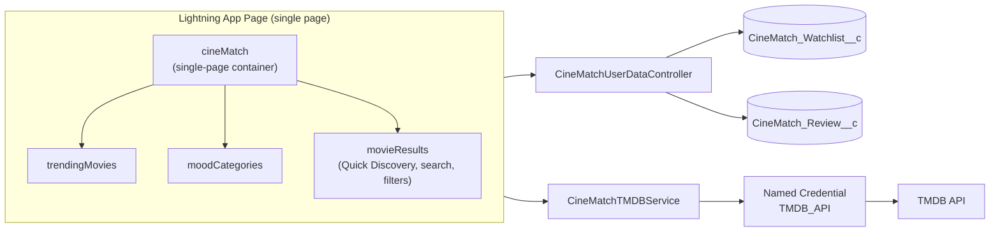
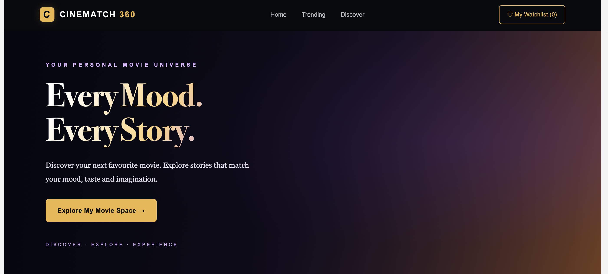
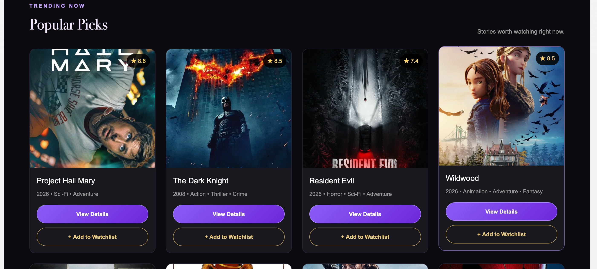
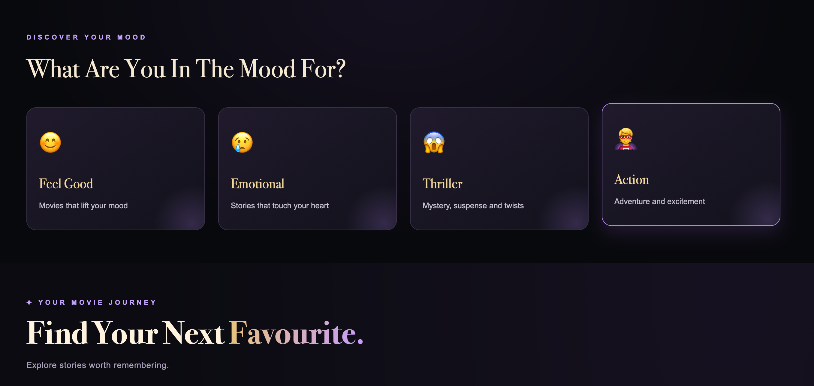
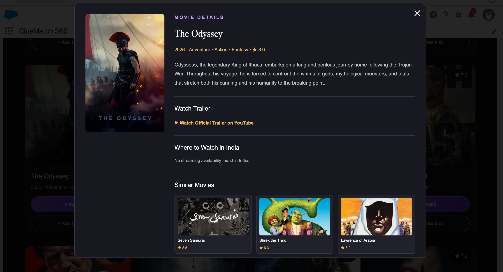
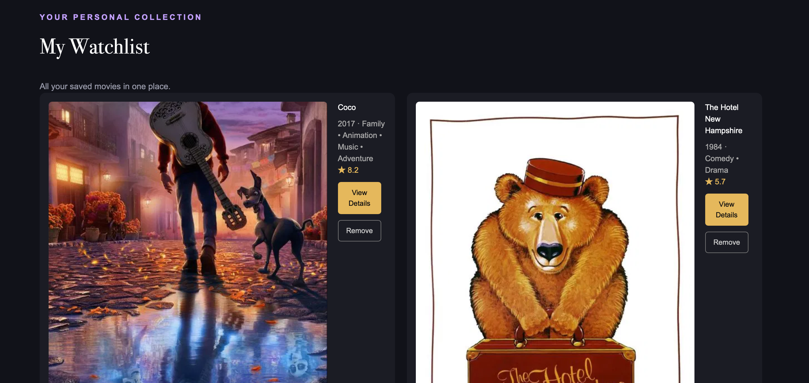

<div align="center">

# 🎬 CineMatch 360

**Your personal movie universe, built natively on Salesforce.**

Discover movies by mood or with Quick Discovery, explore trailers and streaming options in India, and build your own collection with a personal watchlist, ratings and reviews – all in one single-page Lightning Web Components app.


</div>

---

## 📌 About the project

CineMatch 360 is a Salesforce portfolio project: a movie discovery and personal collection app built with Lightning Web Components and an Apex backend. It is a **single-page application**. Home, My Movie Space, Trending (Popular Picks) and Discover are sections of the same page, and My Watchlist and the movie details modal open on that page when needed. Movie data comes from the [TMDB API](https://www.themoviedb.org/), called securely from Apex through a **Named Credential**. Each user's watchlist and reviews are saved in Salesforce custom objects.

This project shows how to:

- build a single-page, multi-component LWC app with parent and child communication,
- call an external REST API from Apex without storing secrets in code,
- save user-specific data in custom objects with secure Apex (`with sharing`, user mode),
- control access with permission sets.

## ✨ Features (implemented)

Every feature in this table exists in the source code.

|     | Feature                                                                                                                                                                                                                                         |
| --- | ----------------------------------------------------------------------------------------------------------------------------------------------------------------------------------------------------------------------------------------------- |
| 🎬  | **Cinematic hero section** – a hero banner with an "Explore My Movie Space →" button                                                                                                                                                            |
| 📊  | **My Movie Space** – a personal dashboard with Saved Movies, Genres Collected and Current Mood cards                                                                                                                                            |
| 🌟  | **Collection Spotlight** – your highest-rated saved movie (by TMDB rating), with a button that opens its details                                                                                                                                |
| 🔥  | **Popular Picks** – a grid of popular movies from TMDB                                                                                                                                                                                          |
| 😊  | **Mood-based discovery** – Feel Good, Emotional, Thriller and Action moods, each linked to a TMDB genre                                                                                                                                         |
| ⚡  | **Quick Discovery** – Under 2 Hours, Top Rated, Hidden Gems, Family Night and Weekend Watch, loaded from TMDB                                                                                                                                   |
| 🔎  | **Search** – search movies by title, with Previous / Next pagination                                                                                                                                                                            |
| 🎛️  | **Filters and sorting** – genre, minimum rating (7+, 8+, 9+) and sort by popularity, rating or year                                                                                                                                             |
| 🎞️  | **Movie details modal** – overview, YouTube trailer link (official trailer preferred) and up to 6 similar movies                                                                                                                                |
| 📺  | **Where to watch in India** – Stream, Rent and Buy providers from TMDB. Each provider button opens the platform's **search page** for the movie title (not a direct movie page). A separate "View all India options" button opens the TMDB page |
| ♡   | **Personal watchlist** – add and remove movies, with a live count in the navigation bar and in My Movie Space                                                                                                                                   |
| ⭐  | **Ratings and reviews** – save a rating (1–10) and a written review (up to 2,000 characters) per movie                                                                                                                                          |
| ⏳  | **Loading skeletons and empty states** – skeleton cards while Discover loads, and friendly messages when there is nothing to show                                                                                                               |
| 🔐  | **Secure by design** – no token in code, user-mode data access, private records, permission sets                                                                                                                                                |

### Single-page navigation

- One component, `cineMatch`, draws the whole page. There are no separate pages or routes.
- The page runs from top to bottom: navigation bar, hero banner, My Movie Space, Popular Picks, Discover, then **My Watchlist** (only when opened) and the **movie details modal** (only when a movie is opened).
- The **Home**, **Trending** and **Discover** links in the navigation bar are in-page anchor links. The **My Watchlist (n)** button shows or hides the watchlist section.
- The hero button scrolls to My Movie Space, and choosing a mood scrolls to the Discover results.

## 🛠️ Technology stack

| Layer          | Technology                                                                                      |
| -------------- | ----------------------------------------------------------------------------------------------- |
| Front end      | Lightning Web Components (JavaScript, HTML, CSS)                                                |
| Back end       | Apex (`with sharing`, `@AuraEnabled`, HTTP callouts)                                            |
| Data           | Custom objects `CineMatch_Watchlist__c` and `CineMatch_Review__c`                               |
| Integration    | TMDB API through Named Credential `TMDB_API` and External Credential `TMDB_External_Credential` |
| Access control | Permission sets, Private sharing model, user-mode queries and DML                               |
| UI hosting     | Lightning App Page and custom tab (`CineMatch`) with the single `cineMatch` component           |
| Testing        | Apex tests with `HttpCalloutMock`, Jest (`@salesforce/sfdx-lwc-jest`)                           |
| Code quality   | ESLint, Prettier, Husky and lint-staged                                                         |
| Tooling        | Salesforce CLI (`sf`), Node.js and npm                                                          |
| API versions   | Source API version 67.0 (project and CineMatch LWC). The CineMatch Apex classes use 68.0        |

## 🏗️ Architecture



- `cineMatch` is the single-page container. It keeps the shared state (watchlist, selected movie, mood), builds My Movie Space and Collection Spotlight from the watchlist, and receives events from its three children.
- `CineMatchTMDBService` calls TMDB through `callout:TMDB_API`.
- `CineMatchUserDataController` reads and writes the user's watchlist and reviews.

👉 Full explanation: [docs/PROJECT_DOCUMENTATION.md](docs/PROJECT_DOCUMENTATION.md)

## 🧩 What is inside

### Lightning Web Components (CineMatch)

| Component        | Role                                                                                                                                                                                             |
| ---------------- | ------------------------------------------------------------------------------------------------------------------------------------------------------------------------------------------------ |
| `cineMatch`      | Single-page container: navigation bar, hero banner, My Movie Space, Collection Spotlight, My Watchlist section, movie details modal (trailer, where to watch, similar movies, rating and review) |
| `trendingMovies` | "Popular Picks" movie grid                                                                                                                                                                       |
| `moodCategories` | The four mood cards                                                                                                                                                                              |
| `movieResults`   | Discover section: Quick Discovery, search, filters, sorting, pagination, loading skeletons and empty state                                                                                       |

### Repository inventory (LWC)

| Group                                | Bundles                                                             | Used by the app?                                    |
| ------------------------------------ | ------------------------------------------------------------------- | --------------------------------------------------- |
| Main CineMatch components            | 4 – `cineMatch`, `trendingMovies`, `moodCategories`, `movieResults` | Yes                                                 |
| Additional CineMatch wrapper bundles | 3 – `cineMatchTrending`, `cineMatchDiscover`, `cineMatchWatchlist`  | No. They are present in the repository but not used |
| Standalone practice components       | 49                                                                  | No                                                  |
| **Total LWC bundle folders**         | **56**                                                              |                                                     |

The `lwc` folder also has **61 JavaScript files**. This is a different count: it is 55 component `.js` files (56 bundles minus `sharedCss`, which is CSS only) plus 6 Jest test files.

The three wrapper bundles each render `cineMatch` with a `page-name` value, but `cineMatch` does not read it and nothing in the repository uses the wrappers. They are not separate pages.

### Apex classes

| Class                             | Role                                                                                                                          |
| --------------------------------- | ----------------------------------------------------------------------------------------------------------------------------- |
| `CineMatchTMDBService`            | TMDB callouts: popular, by genre, Quick Discovery (`getMoviesByQuickFilter`), search, videos, watch providers, similar movies |
| `CineMatchUserDataController`     | Watchlist and review methods (`getWatchlist`, `addToWatchlist`, `removeFromWatchlist`, `getMyReview`, `saveMyReview`)         |
| `CineMatchTMDBServiceTest`        | Tests with an HTTP callout mock                                                                                               |
| `CineMatchUserDataControllerTest` | Tests for watchlist and review logic                                                                                          |

### Custom objects

| Object                   | Purpose                                                                                                                                          |
| ------------------------ | ------------------------------------------------------------------------------------------------------------------------------------------------ |
| `CineMatch_Watchlist__c` | One record per movie saved by a user. Fields: `TMDB_Movie_ID__c`, `Title__c`, `Year__c`, `Genre__c`, `Rating__c`, `Poster_URL__c`, `Overview__c` |
| `CineMatch_Review__c`    | One record per user and movie. Fields: `TMDB_Movie_ID__c`, `Movie_Title__c`, `Rating__c`, `User_Review__c`                                       |

Both objects use the **Private** sharing model.

### TMDB API integration

TMDB is called only from Apex, through Named Credential `TMDB_API` and External Credential `TMDB_External_Credential`.

| Integration                     | How it is used                                                                                                                                                           |
| ------------------------------- | ------------------------------------------------------------------------------------------------------------------------------------------------------------------------ |
| **TMDB API**                    | Movie lists, search, Quick Discovery, videos, watch providers and similar movies, through Named Credential `TMDB_API` and External Credential `TMDB_External_Credential` |
| **TMDB image CDN**              | Movie poster images                                                                                                                                                      |
| **YouTube**                     | Trailer link only (no YouTube API)                                                                                                                                       |
| **Streaming platform websites** | Platform search links for the providers TMDB lists for India (search pages, not direct movie pages)                                                                      |

### Other metadata

- Permission sets: `CineMatch_TMDB_Access`, `CineMatch_User_Data_Access`
- App page and tab: `CineMatch` (the page contains only the `cineMatch` component)
- Static resource: `fightclub` (hero and fallback poster image)

> The repository also holds other Salesforce practice code (49 standalone practice LWC bundles and 11 practice Apex classes) and three unused CineMatch wrapper bundles. None of them is part of the running app. See the [project documentation](docs/PROJECT_DOCUMENTATION.md#2-repository-scope).

## 🚀 Getting started

### Prerequisites

- A Salesforce Developer Edition org or sandbox
- [Salesforce CLI](https://developer.salesforce.com/tools/salesforcecli) (`sf`)
- [Node.js](https://nodejs.org/) and npm
- A free [TMDB](https://www.themoviedb.org/) account and an **API Read Access Token**

### Quick start

```bash
# 1. Get the code
git clone <your-repository-url>
cd <your-repository-folder>
npm install

# 2. Log in to your org
sf org login web --alias cinematch --set-default
```

Then:

1. **Deploy** only the CineMatch metadata (objects, credentials, Apex classes and test classes, permission sets, the four main CineMatch LWC components, app page, tab, static resource). Do not deploy the whole `force-app` folder, because it also holds unrelated practice code. Before you commit or share the project, replace the `Authorization` value in the External Credential file with a placeholder.
2. **Add your own TMDB token** in the External Credential inside Salesforce (`TMDB_External_Credential`). Never save it in a file in Git.
3. **Assign both permission sets** to your user (command below), The `CineMatch_User_Data_Access` permission set includes field permissions for the optional CineMatch custom fields.
4. **Add the CineMatch tab** to a Lightning app and open it. If **Popular Picks** shows movies, your TMDB credential works.

Permission set command:

```bash
sf org assign permset --target-org cinematch --name CineMatch_TMDB_Access

sf org assign permset --target-org cinematch --name CineMatch_User_Data_Access
```

📖 Exact deploy command (with the correct file paths), token steps and troubleshooting: [Installation and deployment](docs/PROJECT_DOCUMENTATION.md#10-installation-and-deployment)

## 🧪 Testing

```bash
# Apex
sf apex run test --target-org cinematch \
  --class-names CineMatchTMDBServiceTest \
  --class-names CineMatchUserDataControllerTest \
  --result-format human --wait 10

# LWC (Jest)
npm run test:unit
```

The Apex tests are written for both CineMatch Apex classes. The author ran them in a Salesforce org, and all 3 passed.

| Test method                                              | Result |
| -------------------------------------------------------- | ------ |
| `CineMatchTMDBServiceTest.testInvalidMovieId`            | Passed |
| `CineMatchTMDBServiceTest.testMovieEndpoints`            | Passed |
| `CineMatchUserDataControllerTest.testWatchlistAndReview` | Passed |

**Overall: 3/3 passed (100% success rate).** Run the tests again in your own org after deploying. Code coverage is not claimed here. `CineMatchTMDBServiceTest` does not call `getMoviesByQuickFilter`.

**Jest tests have not passed and are not claimed to.** The six Jest files in the project (`moodCategories`, `movieResults`, the three wrapper bundles and the practice component `studentCard`) are generated placeholders (`expect(1).toBe(1)`) and are not completed component tests.

## 🔒 Security

- The TMDB token is **not** in the Apex or LWC code. It is stored in an External Credential and used through a Named Credential.
- Apex classes use `with sharing`. User data queries and DML run in user mode.
- Watchlist and review records are private to each user.
- Access is granted with permission sets.
- Every user who deploys the project must configure their own TMDB token in Salesforce External Credentials.
- **Never commit your real TMDB API token to GitHub.** The External Credential metadata in the repository must contain only the placeholder (`REPLACE_WITH_YOUR_TMDB_TOKEN`), not the actual token. Keep the real token only in Salesforce, in `TMDB_External_Credential`.
- Check the External Credential file before every commit or share. If a real token was ever committed or shared, create a new one in your TMDB account.
- Do not commit tokens or secrets to this repository.

## 🔭 Future enhancements (ideas, not implemented)

These are ideas only. They are not part of the current project.

- Real Jest tests for the CineMatch components
- An Apex test for `getMoviesByQuickFilter`
- Removing the three unused wrapper bundles, or deciding what they are for
- A complete `manifest/package.xml` for CineMatch 360
- Server-side filters and sorting that apply to all result pages
- A CineMatch-only repository or branch

See the full list in the [project documentation](docs/PROJECT_DOCUMENTATION.md#131-future-enhancement-ideas-not-implemented).

## 🖼️ Screenshots

### Home



### Popular Picks



### Mood categories



### Movie details



### My Watchlist



> 📷 **Still to add (planned):** My Movie Space dashboard (`02-my-movie-space-dashboard.png`), Collection Spotlight (`03-collection-spotlight.png`), Quick Discovery (`07-quick-discovery.png`) and Where to watch in India with providers (`15-where-to-watch-india.png`). These files do not exist yet. The full list is in [section 14 of the project documentation](docs/PROJECT_DOCUMENTATION.md#14-screenshots-to-add).

## 📚 Documentation

- [Project documentation](docs/PROJECT_DOCUMENTATION.md) – architecture, components, Apex, objects, integrations, deployment, known limitations and the screenshot checklist

## 🙏 Credits

Movie data and images are provided by [TMDB](https://www.themoviedb.org/).

> This product uses the TMDB API but is not endorsed or certified by TMDB.

## 👤 Author

**Divi Nandhu**
<!-- Add your GitHub, LinkedIn or portfolio links here. -->
